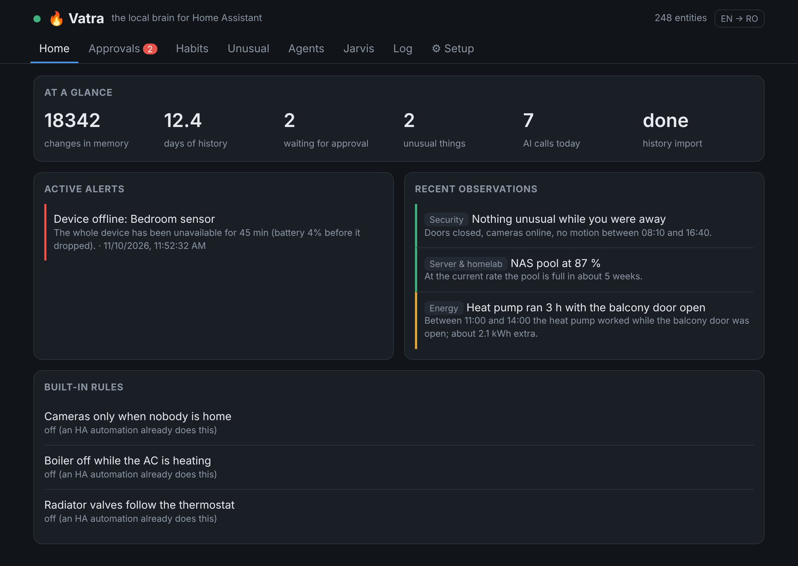
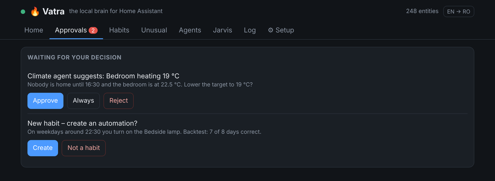
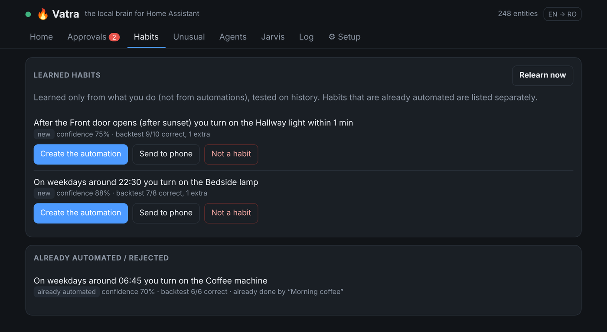
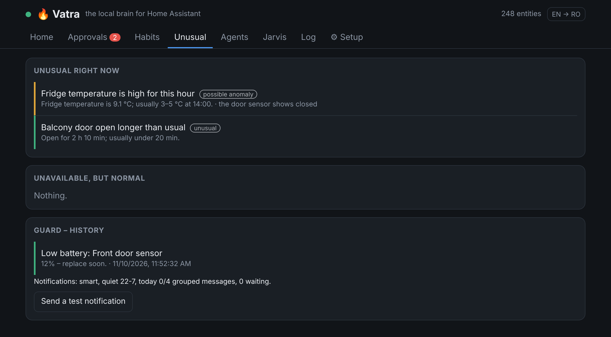
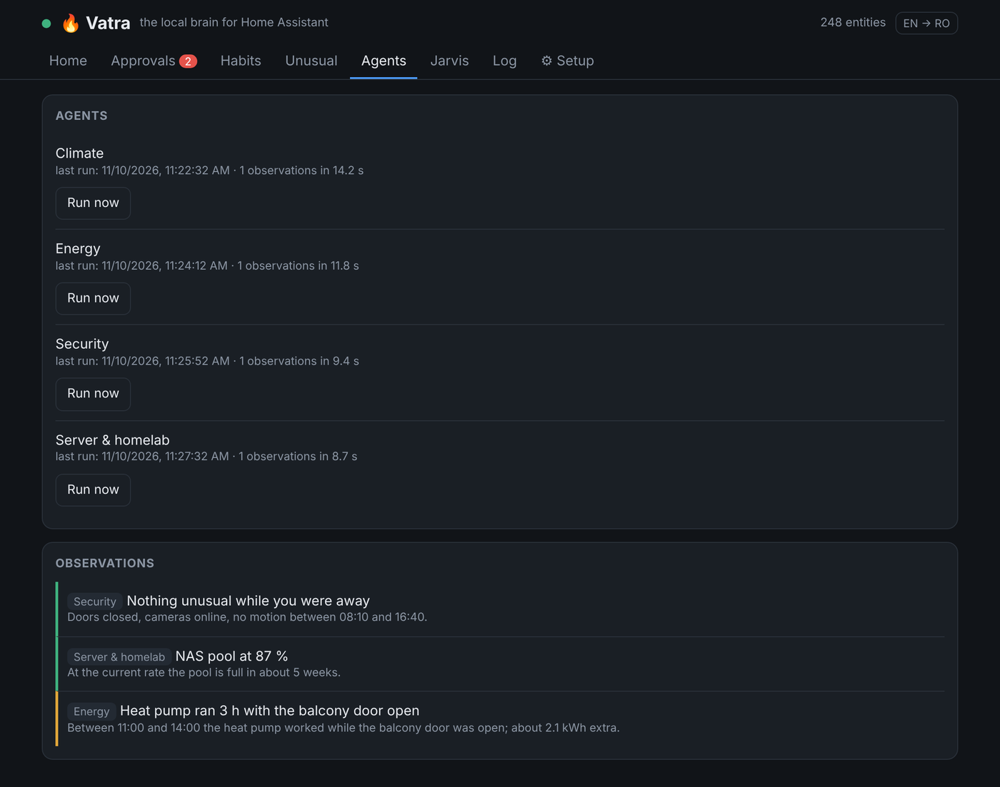
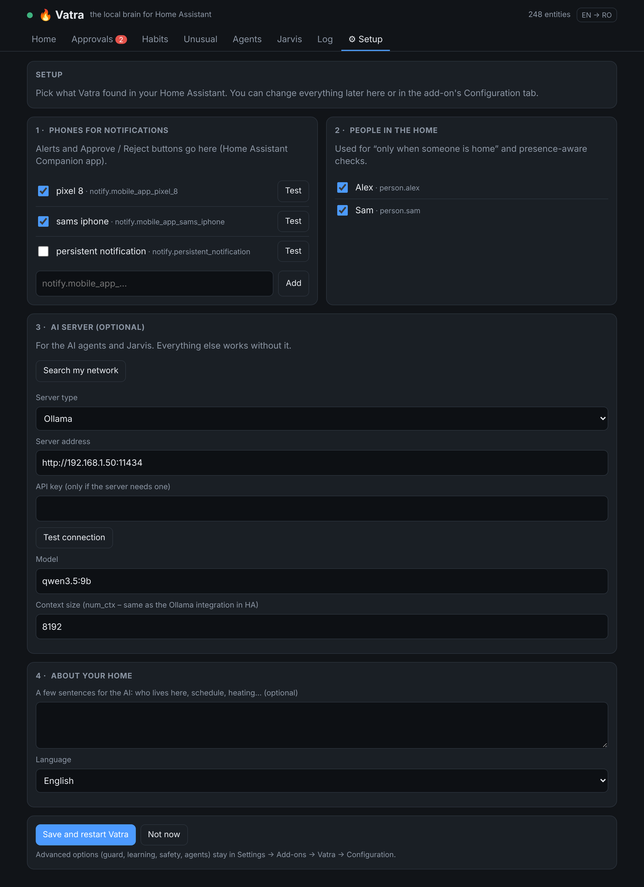
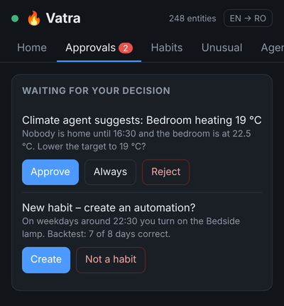

# 🔥 Vatra – the local brain for Home Assistant

[](https://my.home-assistant.io/redirect/supervisor_add_addon_repository/?repository_url=https%3A%2F%2Fgithub.com%2FRazvanR1%2FVatra)


[](https://analytics.home-assistant.io/addons)
[](https://buymeacoffee.com/razvanr1)

**Vatra** (Romanian for *hearth* – the heart of the home) **is a local brain for your home.** It watches what happens in Home Assistant, learns what is
*normal* for **your** house, turns your habits into native HA automations (after you approve them),
tells you when something is unusual, and lets local AI agents look at the harder questions.
Everything runs on your hardware. The AI part (Ollama) is optional and only used when it adds value.

> 🇷🇴 [Descriere în română mai jos](#-pe-scurt-în-română)



---

## What it does

| | |
|---|---|
| 🧭 **Learns your habits** | Only from what *people* do (app, dashboard, wall switch), never from what automations do. Two kinds: *time* habits ("on weekdays around 22:30 you turn on the bedside lamp") and *sequence* habits ("after the front door opens you turn on the hallway light"). |
| 🧪 **Backtests before proposing** | Every habit is replayed on your history: on how many days the automation would have done exactly what you did, and on how many it would have done something extra. Habits already covered by one of your automations are skipped. |
| ✅ **Native automations, with Undo** | When you approve, Vatra creates a normal Home Assistant automation (`home_brain_…`) that you can read, edit or delete like any other — and undo from the panel. |
| 👀 **Notices what's unusual** | No device lists, no thresholds to set. It learns per-hour baselines and flags: abnormal values for the time of day, sensors that went silent, devices flapping on/off, doors or lights left in a state far longer than usual, house open while nobody is home. |
| 📱 **Approve from your phone** | Actionable notifications: **Approve / Always / Reject**, **Undo** after something it did on its own, **Seen / Not a problem** for observations. It learns from your answers. |
| 🛡️ **Safety rails that can't be bypassed** | Locks, alarm, valves, gates and "important" devices (boiler, fridge, server, NAS…) always need approval. Shell commands, Supervisor calls, restarting HA, disabling automations and temperatures outside your limits are blocked outright. |
| 🤖 **Local AI agents** (optional) | Climate, Energy, Security and Server/homelab agents analyse the house every few hours **only if something changed**, one at a time, on a single local model (Ollama or any OpenAI-compatible server). Their findings go to the panel and a single evening digest. |
| 💬 **Jarvis chat** | Ask about the house or give commands in the panel; it also knows what the brain has observed. Commands go through the same safety rails. |
| 🚨 **Guard** | Devices that become unavailable, low batteries — one alert per problem, a summary when many things fail at once, and a "resolved" message when it's fixed. Not fooled by HA restarts. |
| 🖥️ **Sidebar panel** | Home, Approvals, Habits, Unusual, Agents, Jarvis, Log (with Undo) and a **Setup guide**: it finds your phones, people and AI server by itself – no YAML needed. |
| 🌍 **English and Romanian** | Follows your Home Assistant language automatically; the panel has an EN/RO switch. Adding a language is one column in one file. |

### Screenshots

| Approvals – also as buttons on your phone | Habits, backtested on your history |
|---|---|
|  |  |
| **Unusual – three tiers, with context** | **Local AI agents** |
|  |  |
| **Setup guide – no YAML** | **On the phone** |
|  |  |

<sub>Demo data. Everything you see runs locally in the add-on.</sub>

### How it thinks

```
Observe ─► Learn locally (no AI) ─► Decide what matters ─► Think (AI, only if needed) ─► Act or ask
  state       habits, baselines,        new / unusual          domain agents               shadow / co-pilot /
  changes     dwell times, rates        only                   on your Ollama              autonomous + Undo
```

Every state change is stored with its **origin** — a person, the device itself, one of your automations,
or Vatra. That is what lets it learn habits without "learning" your existing automations, and
what keeps it from learning from its own actions.

---

## Requirements

- Home Assistant **OS** or **Supervised** (it is an add-on / app).
- The **Home Assistant Companion app** on your phone for actionable notifications (any `notify.mobile_app_*` service).
- *Optional:* a local AI server for the AI agents and Jarvis – **[Ollama](https://ollama.com)** or any
  **OpenAI-compatible** server (LM Studio, llama.cpp, vLLM, LocalAI, Jan…). A 7–9B model works
  (tested with `qwen3.5:9b` on a 12 GB GPU). Without it, everything except the agents and Jarvis still works.

## Installation

1. Click the **Add repository** button above, or in Home Assistant go to
   **Settings → Add-ons → Add-on Store → ⋮ → Repositories** and add:
   ```
   https://github.com/RazvanR1/Vatra
   ```
2. Install **Vatra**.
3. Start it, turn on **Show in sidebar** and open **Vatra**.
4. The **Setup** guide opens by itself: tick your phones and the people in the home, press
   **Search my network** to find your AI server (optional), then **Save and restart**. That's it.

Prefer YAML? Everything is also in the add-on's **Configuration** tab:
```yaml
notify_services:
  - notify.mobile_app_your_phone
learning:
  persons: [person.you, person.partner]
assistant:
  backend: ollama                          # or: openai (LM Studio, llama.cpp, vLLM…)
  ollama_url: "http://192.168.1.50:11434"  # optional
  # openai_url: "http://192.168.1.50:1234/v1"
  model: "qwen3.5:9b"
```

On first start it imports the last 10 days of history, so habits and baselines are available within
minutes instead of weeks. Habits keep improving as more days accumulate.

## Configuration (most useful options)

| Option | Default | What it does |
|---|---|---|
| `language` | `auto` | `auto` follows Home Assistant (Romanian if HA is in Romanian, English otherwise), or force `en` / `ro`. |
| `site_context` | — | A few sentences about your home (who lives there, schedule, heating…). Given to the AI agents and Jarvis. |
| `notify_services` | `[]` | Where alerts and approval requests go. Buttons work with `mobile_app_*`. |
| `learning.persons` | `[]` | Used for "only when someone is home" conditions and presence-aware checks. |
| `learning.max_proposals_per_day` | `2` | How many new habit proposals may reach your phone per day. |
| `unusual.open_away` | `false` | Alert when doors/windows are open and nobody is home (off by default in case you already have such an automation). |
| `notifications.mode` | `smart` | `smart`: critical at once, the rest grouped; `all`: everything at once; `critical_only`. |
| `notifications.quiet_hours` | `22-7` | Only critical alerts at night; approvals wait until morning. |
| `notifications.max_per_day` | `4` | Grouped non-critical messages per day; the rest stay in the panel. |
| `unusual.max_push_per_day` | `5` | Cap on critical / confirmed-fault observations pushed per day. |
| `safety.autonomy` | `copilot` | `shadow` (only log what it would do), `copilot` (ask), `autonomous` (do safe things, offer Undo). Per domain: `autonomy_overrides: ["light:autonomous"]`. |
| `safety.min/max_temperature` | `16` / `26` | Hard limits for any temperature it may set. |
| `agents.notify` | `digest` | `none`, `digest` (one summary at `digest_hour`), or `critical`. |
| `agents.allow_actions` | `false` | Let agents propose device actions (always via approval). |
| `assistant.backend` | `ollama` | `ollama` (native API) or `openai` (any OpenAI-compatible server: LM Studio, llama.cpp, vLLM, LocalAI…). |
| `assistant.openai_url` / `api_key` | — | Address of the OpenAI-compatible server (e.g. `http://IP:1234/v1`) and a key, only if it needs one. |
| `assistant.num_ctx` | `8192` | Ollama only: keep it equal to your Ollama integration in HA so the model isn't reloaded. |

The full list with explanations is in the add-on's **Documentation** tab ([DOCS.md](ha_home_brain/DOCS.md)).

## Privacy

- No cloud, no telemetry. Data stays in the add-on's `/data/brain.db` (SQLite) on your HA machine.
- The only outbound calls are to your own AI server (if configured) and to Home Assistant.
  The setup guide's **Search my network** only looks for AI servers on your local network, and only when you press it.
- The panel only answers requests that come through Home Assistant's ingress.

## Current limitations

- Languages: English and Romanian. Want another one? Add a column in `app/i18n.py`, the panel
  dictionary in `app/static/index.html` and `translations/<lang>.yaml` — PRs welcome.
- Small local models can misread data. That is why agents only make observations by default and
  everything that touches a device goes through approval.
- Habit learning needs a few days of history with consistent behaviour (default: ≥ 4 days, ≥ 60 %).

## Development

```bash
pip install -r ha_home_brain/requirements.txt pytest pytest-asyncio
pytest
```

The tests start a fake Home Assistant (WebSocket + REST) and a fake Ollama, and cover habit mining
and backtesting, anomaly detection, approvals from notification buttons, guardrails, Undo, and the
guard surviving HA restarts.

Code map: `ha.py` (HA client, origin tracking) · `recorder.py` + `store.py` (memory) ·
`habits.py` (habit mining, backtest, automation builder) · `anomaly.py` (baselines, detectors) ·
`approvals.py` (notifications, guardrails, Undo) · `agents.py` + `llm.py` (AI agents) ·
`assistant.py` (Jarvis) · `guard.py` · `web.py` + `static/index.html` (panel).


## Support

Vatra is free and open source, built in my spare time. If it helps your home, you can buy me a coffee ☕ – it keeps the project going.

<a href="https://buymeacoffee.com/razvanr1"></a>

## License

[MIT](LICENSE)

---

## 🇷🇴 Pe scurt, în română

**Vatra – the local brain for Home Assistant.** Vatra e un add-on pentru Home Assistant care rulează complet local și face patru lucruri:

- **Învață ce faci tu.** Pornește doar de la acțiunile oamenilor, nu de la cele făcute de automatizări. Fiecare obicei îl testează întâi pe istoric și abia apoi ți-l propune ca automatizare nativă în HA, pe care o poți anula oricând.
- **Îți spune când ceva e neobișnuit**, fără să-i dai vreo listă de dispozitive. Învață singur ce e normal în casa ta.
- **Te întreabă pe telefon** înainte să facă ceva, cu butoanele Aprobă / Mereu / Respinge / Anulează. Unele acțiuni nu le poate face nici dacă vrea: are reguli de siguranță fixe.
- **Folosește agenți AI locali** (climă, energie, securitate, server) prin Ollama sau orice server compatibil OpenAI (LM Studio, llama.cpp, vLLM…), doar când s-a schimbat ceva în casă.

**Instalare:** în Settings → Add-ons → Add-on Store → ⋮ → Repositories adaugi
`https://github.com/RazvanR1/Vatra`, instalezi **Vatra**, îl pornești și deschizi panoul.
Ghidul **Configurare** se deschide singur: bifezi telefoanele și persoanele, apeși **Caută în rețea**
pentru serverul AI (opțional), apoi **Salvează și repornește**. Fără YAML.
Vatra vorbește română automat dacă Home Assistant e în română (opțiunea `language`).
Documentația completă în română: [DOCS.ro.md](ha_home_brain/DOCS.ro.md).

Dacă Vatra îți e de folos, mă poți susține cu o cafea: [buymeacoffee.com/razvanr1](https://buymeacoffee.com/razvanr1) ☕
